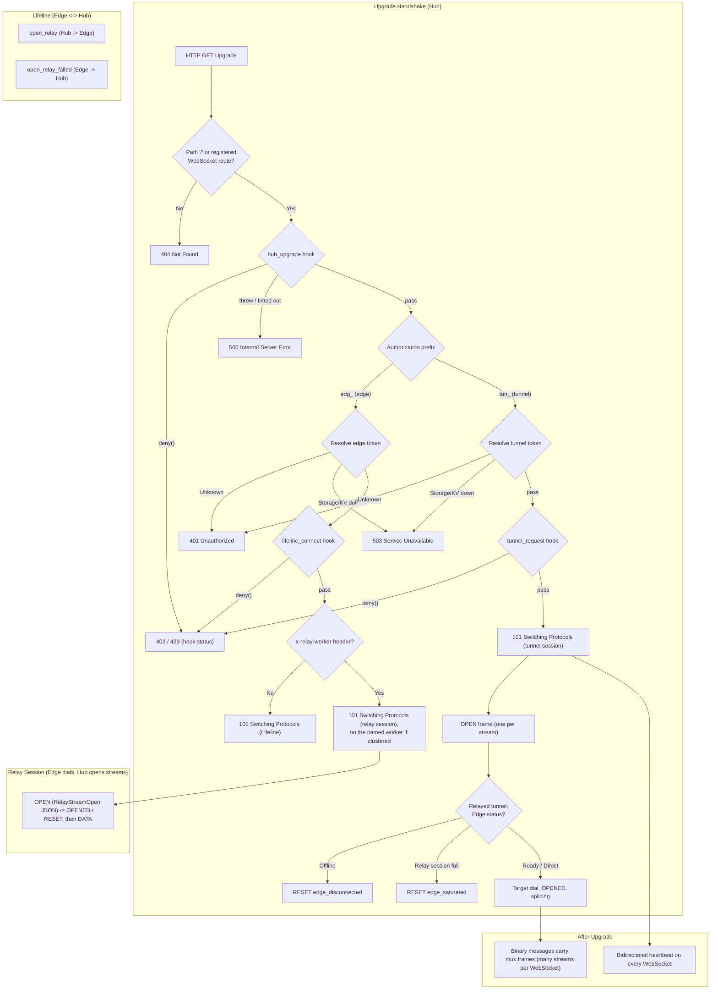

# Wire Protocol Specification



This document is the normative reference for everything that crosses a network boundary: upgrade handshakes, heartbeats, lifeline orders, relay sessions, data framing, timeouts, rejection statuses, close codes, and close reasons. Terms are defined in the [Glossary](glossary.md).

---

## 1. Upgrade Handshake

All WebSocket connections (runtime sockets, lifelines, relay sessions) are HTTP/1.1 upgrades on the root path `/`:

```http
GET / HTTP/1.1
Host: tunnels.example.com
Upgrade: websocket
Connection: Upgrade
Sec-WebSocket-Key: dGhlIHNhbXBsZSBub25jZQ==
Sec-WebSocket-Version: 13
Authorization: tun_4f8a9e2d1c3b...
x-request-id: 7d0c6c1e-2f55-4a8e-9b61-0a3d1f2e4b5c
version: 0.1.0
```

| Header           | Required            | Description                                                                                                                                                                                                                                                                                                            |
| :--------------- | :------------------ | :--------------------------------------------------------------------------------------------------------------------------------------------------------------------------------------------------------------------------------------------------------------------------------------------------------------------- |
| `Authorization`  | Yes                 | The raw token, with no scheme prefix: a tunnel token (`tun_...`) or edge token (`edg_...`). The core does not strip `Bearer ` or any other prefix; a `hub_upgrade` hook may normalize the header before classification.                                                                                                |
| `x-relay-worker` | Relay sessions only | The Hub worker identity (`<bootId>:<workerId>`) named in the [`open_relay`](#a-open_relay-hub--edge) order the Edge is answering. An edge-token upgrade with this header is a relay session; without it, a lifeline.                                                                                                   |
| `x-request-id`   | No                  | Client-supplied correlation id. Kept only as `correlationId` in logs and forwarded to Edges. It is never used as a key. The Hub always generates its own `reqId` (UUIDv4).                                                                                                                                             |
| `version`        | No                  | Informational semver of the connecting runtime or Edge. Recorded (for Edges, stored as `edge.version`) but never used to accept or reject a connection. The protocol is not versioned. The Edge currently sends the fixed string `0.1.0` on its lifeline (not its package version) and no `version` on relay sessions. |

The token prefix determines how the connection is handled: `tun_` = runtime socket, `edg_` = lifeline, or relay session when `x-relay-worker` is present.

> [!NOTE]
> **Browser Compatibility**: The standard browser WebSocket API specification ([WHATWG WebSocket API](https://websockets.spec.whatwg.org/)) does not permit setting custom HTTP request headers (such as `Authorization`) during the WebSocket handshake. For this reason, standard browser WebSockets connecting directly to Hub tunnel endpoints cannot supply an `Authorization` header and are rejected with `401 Unauthorized`.
>
> In the **FullStacked runtime**, `window.WebSocket` is overridden by FullStacked's `WebSocketCore`. To connect through a tunnel, the application registers it using `tunnel.register({ host, authorization, name? })` from `fullstacked/tunnel`. Calling `tunnel.register` returns a generated string (or uses the supplied custom `name`). When you create your WebSocket with that tunnel name:
>
> ```typescript
> const tunnelName = await tunnel.register({
>     host: "tunnels.example.com", // wss:// on port 443 by default
>     authorization: "tun_4f8a9e2d1c3b...",
> });
> const tunneledWS = new window.WebSocket("ws://" + tunnelName);
> ```
>
> FullStacked's `WebSocketCore` will use tunnels with the registered `authorization` credentials.

### Rejection Statuses

Before `101 Switching Protocols`, the Hub rejects with an HTTP status and a JSON body (`Content-Type: application/json`, body produced with `JSON.stringify`):

| Status                      | Produced by                  | Scenario                                                                                                                | Body                                |
| :-------------------------- | :--------------------------- | :---------------------------------------------------------------------------------------------------------------------- | :---------------------------------- |
| `401 Unauthorized`          | Core only                    | `Authorization` missing, prefix unrecognized, or token does not resolve (unknown, rolled or deleted tunnel/edge token). | `{"error":"Unauthorized"}`          |
| `403 Forbidden`             | Hooks (`req.deny()` default) | Valid credential refused by policy.                                                                                     | `{"error":"Denied"}`                |
| `404 Not Found`             | Core                         | Non-root path without a registered WebSocket route.                                                                     | `{"error":"Not Found"}`             |
| `429 Too Many Requests`     | Hooks (`req.deny(429, ...)`) | Rate limited. The hook may set `Retry-After` (seconds).                                                                 | `{"error":"Too Many Requests"}`     |
| `500 Internal Server Error` | Core                         | A gating hook threw or exceeded `HOOK_TIMEOUT` (fail-closed).                                                           | `{"error":"Internal Server Error"}` |
| `503 Service Unavailable`   | Core                         | Storage or KV unavailable while resolving the token. The core never reports this case as `401`.                         | `{"error":"Service Unavailable"}`   |

Edge liveness (`edge_disconnected`) and saturation (`edge_saturated`) are per stream: they are signaled after `101 Switching Protocols` with a `RESET` carrying the reason, ensuring uniform behavior across single-process and clustered deployments.

### Client Retry Policy

Only `401` means "this credential is not valid". Every other rejection is transient.

| Status                               | Edge lifeline                                                      | Relay session                                                                                      |
| :----------------------------------- | :----------------------------------------------------------------- | :------------------------------------------------------------------------------------------------- |
| `401`                                | Enter the [revoked state](../2-nodes/edge.md#revocation-handling). | Retry once after 200 ms, then send `open_relay_failed` (waiting streams fail `relay_dial_failed`). |
| `403`                                | Retry with backoff jumped to `MAX_RECONNECT_INTERVAL`.             | Same as `401`.                                                                                     |
| `429`                                | Retry after `Retry-After` if present, else normal backoff.         | Same as `401`.                                                                                     |
| `500`, `503`, network error, timeout | Retry with normal exponential backoff.                             | Same as `401`.                                                                                     |

A failed relay session dial never affects the lifeline. A lifeline closed with code `1000` and reason `token_rolled` or `edge_deleted` is treated exactly like a `401`.

---

## 2. Lifeline Protocol

A lifeline carries WebSocket control frames (heartbeat ping/pong) and JSON text frames (opcode `0x1`) called orders. Every order has a `type` field. IPC messages between processes use the same `type` discriminator. A lifeline never carries tunnel data: streams travel on [relay sessions](#c-relay-sessions), which the Edge dials when the Hub orders it to.

### A. `open_relay` (Hub → Edge)

```json
{
    "type": "open_relay",
    "worker": "6f1c2a9e:3"
}
```

| Field    | Description                                                                                                                         |
| :------- | :---------------------------------------------------------------------------------------------------------------------------------- |
| `worker` | Identity of the Hub worker that wants the session. The Edge sends it back in the `x-relay-worker` header of the relay session dial. |

The Edge dials one relay session to `HUB_URL`, presenting its edge token (re-read from `TOKEN_FILE` on every dial, so a rolled token is picked up) and `x-relay-worker: <worker>`. A failed dial (rejected upgrade or network error) is retried once after 200 ms. Orders are sent by the lifeline worker, on behalf of itself or of another worker (see [Warden](../3-subsystems/warden.md#2-relay-sessions)).

### B. `open_relay_failed` (Edge → Hub)

```json
{
    "type": "open_relay_failed",
    "worker": "6f1c2a9e:3"
}
```

Sent when both dials for an `open_relay` failed, or, on a multi-worker Edge, when no Edge worker is available to dial it. The Hub fails the streams that `worker` has waiting for a relay session of this Edge with `relay_dial_failed`.

### C. Relay Sessions

A relay session is a WebSocket the Edge dials to the Hub worker named in `open_relay`. It runs the [data framing](#4-data-framing) of tunnel sessions with the roles reversed: the **Hub** opens streams, the **Edge** accepts them, one stream per runtime stream of a relayed tunnel. Each `OPEN` carries a JSON payload (`RelayStreamOpen`):

```json
{
    "reqId": "c8b4d8a1-5369-42b7-a3f2-1a7f4e912345.7",
    "tunnel": {
        "id": "e4b1b36e-7117-48f5-9cf2-4916a04874b3",
        "name": "postgres-prod",
        "internalHost": "127.0.0.1",
        "internalPort": 5432,
        "metadata": { "userId": "usr_9a8b7c6d" }
    },
    "client": {
        "ip": "203.0.113.1",
        "correlationId": "7d0c6c1e-2f55-4a8e-9b61-0a3d1f2e4b5c"
    },
    "connectTimeoutMs": 9985
}
```

| Field                  | Description                                                                                                                      |
| :--------------------- | :------------------------------------------------------------------------------------------------------------------------------- |
| `reqId`                | The Hub's request id of the runtime stream (`<session id>.<stream id>`), for logs.                                               |
| `tunnel`               | The target and metadata. Never includes the tunnel token or `edgeId`.                                                            |
| `client.ip`            | The runtime's client IP as resolved by the Hub (see [Client IP](../3-subsystems/http-server.md#client-ip-resolution)).           |
| `client.correlationId` | The runtime's `x-request-id`, if any.                                                                                            |
| `connectTimeoutMs`     | **Required.** Milliseconds left before the deadline when the `OPEN` was written. Relative, so Hub/Edge clock skew is irrelevant. |

No other client headers are ever forwarded.

The Edge answers `OPENED` once the target is connected, or `RESET` with the reason:

| `reason`             | Condition                                                                                                                        |
| :------------------- | :------------------------------------------------------------------------------------------------------------------------------- |
| `hook_denied`        | `edge_tunnel_request` called `context.deny()`.                                                                                   |
| `hook_error`         | `edge_tunnel_request` threw or exceeded `HOOK_TIMEOUT`.                                                                          |
| `target_unreachable` | Target dial failed (`ECONNREFUSED`, `EHOSTUNREACH`, `ENETUNREACH`, DNS failure).                                                 |
| `connect_timeout`    | `connectTimeoutMs` expired before the target connected, or the dial failed with any other error.                                 |
| `stream_error`       | The `OPEN` payload is not a valid `RelayStreamOpen`.                                                                             |
| `stream_limit`       | The relay session already carries `MAX_STREAMS_PER_RELAY` (256) streams. The Hub never opens past that limit (`edge_saturated`). |

The Hub forwards the Edge's reason to the runtime stream verbatim. A `RESET` from the Hub (the runtime stream ended first, or the Hub's deadline passed) makes the Edge drop the stream: while `edge_tunnel_request` runs, the stream is dropped right after it, without a dial; during the dial, the dial is dropped and reported with the Hub's reason. After `OPENED`, the stream is spliced 1:1 to the target socket: a clean end on either side is a `FIN`, an error a `RESET` with its reason, which the Hub propagates to the runtime stream verbatim.

A relay session carries any number of streams up to that limit and outlives them: the Hub closes it once idle (see [Warden](../3-subsystems/warden.md#2-relay-sessions)). Closing a relay session ends every stream on it with the close reason.

### D. Relayed Failure Reason Sources

Every failed relayed stream reaches the runtime (`RESET`) with exactly one reason, and `tunnel_end` reports the same reason for every stream that passed the liveness check. A stream refused by the liveness check itself (the Edge has no presence: `edge_disconnected`; KV unavailable while checking presence: `stream_error`) is answered before `tunnel_start`, so neither `tunnel_start` nor `tunnel_end` fires for it (see [Tunnel Handler](../3-subsystems/tunnel-handlers.md#session-lifecycle)).

| Observed by     | Condition                                                                                                                                             | Reason                                                         |
| :-------------- | :---------------------------------------------------------------------------------------------------------------------------------------------------- | :------------------------------------------------------------- |
| Edge            | `RESET` on the relay stream, before or after `OPENED`                                                                                                 | The Edge's reason, verbatim.                                   |
| Hub             | Deadline passed while waiting for a relay session or for `OPENED`                                                                                     | `connect_timeout`                                              |
| Hub             | The Edge could not dial the relay session the worker asked for (`open_relay_failed`)                                                                  | `relay_dial_failed`                                            |
| Hub             | No lifeline to send `open_relay` on, the lifeline dropped while the stream waited on the lifeline worker, or the relay session closed before `OPENED` | `edge_disconnected`                                            |
| Hub             | The chosen relay session already carries `MAX_STREAMS_PER_RELAY` (256) streams                                                                        | `edge_saturated`                                               |
| Hub (clustered) | The relay request reached a lifeline worker that had died                                                                                             | `target_worker_dead`                                           |
| Hub             | Runtime ended the stream before `OPENED`                                                                                                              | `client_aborted`, or the runtime's `RESET` reason (hooks only) |
| Hub             | KV unavailable while checking presence or locating the lifeline worker                                                                                | `stream_error`                                                 |
| Hub             | Hub shutting down while the stream waited for a relay session                                                                                         | `hub_shutdown`                                                 |
| Hub             | Edge token rolled or Edge deleted while the stream waited for a relay session                                                                         | `token_rolled` / `edge_deleted`                                |

A lifeline drop only fails the streams waiting on the lifeline worker itself (`edge_disconnected`, or `hub_shutdown` on Hub shutdown). In clustered mode, streams waiting for a relay session on other workers are not told: they fail at their deadline with `connect_timeout`.

When the Hub gives up on a stream it already opened on a relay session (deadline, runtime abort), it sends the Edge a `RESET` with the same reason.

### E. Saturation

The lifeline only carries `open_relay` orders, bounded by the session cap, so it has no saturation limit. Saturation is per relay session: a Hub worker gives each new stream an idle relay session of the Edge, asking for one more (and waiting up to 1 s for it) when every session carries a stream, up to 64 sessions per Edge per worker, then shares the session with the fewest streams, skipping clogged ones (see [Warden](../3-subsystems/warden.md#placement)). When the chosen session already carries `MAX_STREAMS_PER_RELAY` (256) streams, the stream is answered `RESET edge_saturated` (close code `1013`) and `tunnel_end` reports `edge_saturated`. This happens after the runtime's `OPEN` and `tunnel_start`, in every mode.

---

## 3. Heartbeat (All WebSocket Connections)

The bidirectional heartbeat runs on **every** WebSocket connection: lifelines, runtime sockets, and relay sessions. It exists to keep each connection alive across all NATs, firewalls, reverse proxies, and load balancers on the path, and to detect dead peers.

- Both ends send a WebSocket `ping` every `HEARTBEAT_INTERVAL` (default 10s, shorter than the idle timeout of common proxies and load balancers) and answer every `ping` with a `pong`.
- Any frame received (pong, ping, text, or binary) refreshes the peer's `lastReceived` timestamp.
- A connection is dead when `now - lastReceived >= HEARTBEAT_TIMEOUT` (default 30s). A close frame with code `1011` and reason `heartbeat_timeout` is sent and the underlying socket is destroyed after a 1-second grace period without waiting for the dead peer's close handshake. Local close handling (`lifeline_disconnect`, `tunnel_end`, Edge reconnect) reports `heartbeat_timeout`.
- `HEARTBEAT_INTERVAL` can be shortened for infrastructure with more aggressive idle timeouts, or lengthened to reduce control traffic. It must stay well below `HEARTBEAT_TIMEOUT`.
- Heartbeats are driven by one shared sweep timer per process that iterates over open connections; no timer is allocated per connection.
- Ping and pong are control frames: they never appear in the byte stream delivered to either end.
- Target sockets are plain TCP and never cross a WebSocket proxy; they use OS-level TCP keepalive (`socket.setKeepAlive(true, 60000)`).

On a lifeline, the Hub additionally records presence (see [Warden](../3-subsystems/warden.md#presence)). On the Edge, a dead lifeline triggers the reconnect loop.

---

## Connection Establishment Budget

A single deadline, owned by the Hub, bounds the setup of each stream. There are no per-stage ratios.

1. **Deadline**: when a stream opens (`OPEN` on a tunnel session) the Hub computes `deadline = now + CONNECT_TIMEOUT` (default 10s). The deadline never leaves the worker that holds the stream: relay sessions come to that worker, so no deadline travels over IPC.
2. **Relay session**: if the Edge has no relay session on this worker, the Hub asks for one (`open_relay`, written by the lifeline worker) and waits until one is up, a failure is reported, or `deadline`. At `deadline` the stream fails with `connect_timeout`.
3. **OPEN**: when opening the stream on a relay session, `connectTimeoutMs = deadline - now`. If this is not positive, no `OPEN` is sent and the stream fails with `connect_timeout`.
4. **Edge**: once `edge_tunnel_request` passed, fires `edge_tunnel_start(context, tunnel)` and dials the target with a timer of `connectTimeoutMs`. When the timer fires first it dispatches `edge_tunnel_timeout`, destroys the dial, and answers `RESET connect_timeout`.
5. **Hub wait**: the Hub waits for `OPENED` until `deadline`. At `deadline` it fails the runtime stream with `connect_timeout` and sends `RESET connect_timeout` on the relay stream, which makes the Edge drop its dial.
6. **Direct connections**: the Hub's target dial is bounded by a connect timer of `CONNECT_TIMEOUT` that is cleared on `connect`. `socket.setTimeout()` is never used for this, because it is an idle timeout that would later kill quiet, established sessions.

| Timer                    | Owner                 | Value                                        |
| :----------------------- | :-------------------- | :------------------------------------------- |
| Wait for a relay session | Hub (stream's worker) | until `deadline`                             |
| Wait for `OPENED`        | Hub (stream's worker) | until `deadline`                             |
| Relayed target dial      | Edge                  | `connectTimeoutMs`, from the end of the gate |
| Relay session dial retry | Edge                  | one retry, 200 ms after a failed dial        |
| Direct target dial       | Hub                   | `CONNECT_TIMEOUT`, cleared on connect        |

---

## 4. Data Framing

A runtime upgrade with a tunnel token opens a **tunnel session**: one WebSocket that carries any number of **streams**, each one TCP connection to the tunnel's target. Authentication and the gating hooks run once per session; every stream runs its own Edge liveness check, target dial, `tunnel_start` / `tunnel_connected` / `tunnel_end` hooks (with a request of its own: `id` is `<session id>.<stream id>`, plus `muxStreamId` and `openedAt`), and splicing. The runtime decides how many sessions to hold and which one a new stream goes on (it opens more when its sessions are busy, see the runtime's tunnel pool).

[Relay sessions](#c-relay-sessions) between the Hub and an Edge use the same frames, with the Hub as the opener and the Edge as the acceptor; for a relayed tunnel, each runtime stream is spliced 1:1 to a stream on one of the Edge's relay sessions.

1. Each binary WebSocket message (opcode `0x2`) is exactly one frame: `[type u8][stream id u32 big-endian][payload]`.

    | Type | Name     | Direction                 | Payload                                                                                       |
    | :--- | :------- | :------------------------ | :-------------------------------------------------------------------------------------------- |
    | `1`  | `OPEN`   | Runtime → Hub, Hub → Edge | none on a tunnel session; on a relay session, the [`RelayStreamOpen`](#c-relay-sessions) JSON |
    | `2`  | `OPENED` | Hub → Runtime, Edge → Hub | none: the target is connected                                                                 |
    | `3`  | `DATA`   | Both                      | stream bytes, verbatim, at most 32 KiB per frame                                              |
    | `4`  | `WINDOW` | Both                      | u32 big-endian credit increment                                                               |
    | `5`  | `FIN`    | Both                      | none: the sender has no more bytes                                                            |
    | `6`  | `RESET`  | Both                      | utf-8 [close reason](#close-reason-taxonomy): the stream is over (after a `FIN`, see below)   |

2. The opener (the runtime on a tunnel session, the Hub on a relay session) picks stream ids, increasing, and never reuses one on a session. The runtime may send `DATA` right after `OPEN`, before `OPENED`; the Hub holds those bytes until the target is spliced (the Hub itself sends no `DATA` on a relay stream before `OPENED`). A failed dial answers `RESET` with the reason instead of `OPENED`. A session over its stream limit (256, on tunnel sessions and relay sessions alike) answers `RESET stream_limit`.
3. **Flow control**: each side may send 256 KiB of `DATA` per stream beyond what the other side credited back; the receiver sends `WINDOW` as its consumer reads, so one slow stream never stalls the others on the WebSocket. A receiver that gets more `DATA` on a stream than it has credited ends that stream with `RESET stream_error` (the session and its other streams carry on), so a peer ignoring flow control cannot grow the receiver's buffers.
4. `permessage-deflate` is disabled on every WebSocket. The Hub and the Edge accept WebSocket messages up to 64 KiB (a frame is at most 32 KiB of `DATA` plus its 5-byte header); a larger message closes the WebSocket with `1009 Message Too Big`.
5. The port a driver uses on the virtual host returned by `tunnel.register` is a runtime-side detail and is never sent to the Hub. The target is always `internalHost:internalPort` of the tunnel resolved from the token. `tunnel.register` itself takes the Hub's hostname as `host` (for example `tunnels.example.com`), with a separate `port` (default `443`, or `80` with `unsecure`) and `unsecure: true` for a plain `ws://` Hub.
6. Closing the WebSocket ends every stream on it with the close reason. Severing (revocation, quota, tunnel updates) closes whole tunnel sessions; severing an Edge also closes its relay sessions.

### Symmetrical Teardown (No Half-Close)

- When either side of a stream ends (`FIN` or target FIN), the end is carried to the other side (a `FIN` on the stream, or a TCP FIN to the target) once its pending bytes are flushed, then both are torn down. TCP half-close is not kept open.
- The teardown resets the mux stream with the end reason: a clean end is a `FIN` followed by `RESET client_close` or `RESET target_close` (whichever side ended first), not `FIN` both ways. Errors and aborts send `RESET` with their reason, without a `FIN`.
- A `RESET` received after the peer's `FIN` only carries the reason: the bytes the peer sent before its `FIN` are still delivered to the consumer, then the stream closes (after at most 5 seconds if the consumer never reads them). A `RESET` without a prior `FIN` discards the stream at once.
- The WebSocket close codes in [Close Codes](#5-close-codes) apply to whole sessions (tunnel sessions, relay sessions) and lifelines.

Protocols that work: PostgreSQL, MySQL/MariaDB, Redis, MongoDB, HTTP/1.1 (including keep-alive), HTTP/2 and gRPC, and interactive SSH sessions. Protocols that do **not** work: any client that half-closes its write side (`shutdown(SHUT_WR)`) and then waits for a reply on the read side, for example some HTTP/1.0 clients or `nc -N`-style request/response pipes.

---

## 5. Close Codes

| Code   | Name             | Reasons                                                                                                                                       |
| :----- | :--------------- | :-------------------------------------------------------------------------------------------------------------------------------------------- |
| `1000` | Normal Closure   | `client_close`, `target_close`, `token_rolled`, `tunnel_deleted`, `tunnel_updated`, `edge_deleted`, `superseded`, `client_aborted` (internal) |
| `1001` | Going Away       | `hub_shutdown`, `edge_shutdown`                                                                                                               |
| `1008` | Policy Violation | `hook_denied`                                                                                                                                 |
| `1011` | Internal Error   | `hook_error`, `stream_error`, `target_worker_dead`, `heartbeat_timeout`                                                                       |
| `1013` | Try Again Later  | `edge_saturated`, `stream_limit`                                                                                                              |
| `1014` | Bad Gateway      | `target_unreachable`, `connect_timeout`, `relay_dial_failed`, `edge_disconnected`                                                             |

One more code comes from the WebSocket library rather than the taxonomy: a message over 64 KiB is answered `1009 Message Too Big`, with no reason; the side that refused it reports the close like any other one without a taxonomy reason (below).

## Close Reason Taxonomy

Only these strings are ever sent in close frames and `RESET` frames or reported as the primary taxonomy reason in `tunnel_end`, `edge_tunnel_end`, and `lifeline_disconnect`. A peer that closes with a reason outside the taxonomy (or none) is reported as `client_close` when the peer is on the runtime side (runtime sockets and lifelines on the Hub, relay sessions on the Edge) and as `target_close` when it is on the target side (relay sessions on the Hub; a relayed stream still waiting for `OPENED` reaches no target, so it reports `edge_disconnected` instead). There are no dynamic messages across the wire (details go to logs), so every reason fits the 123-byte limit of RFC 6455 §5.5 without truncation. For internal telemetry hooks (`tunnel_end` and `edge_tunnel_end`), the underlying Node.js `Error` instance (if any) is passed as an optional fourth parameter (`error?: Error`) for logging and diagnostic inspection.

| Reason               | Applies to                       | Meaning                                                                                                                                                                                                                                                                |
| :------------------- | :------------------------------- | :--------------------------------------------------------------------------------------------------------------------------------------------------------------------------------------------------------------------------------------------------------------------- |
| `client_close`       | Stream                           | The runtime ended the stream cleanly.                                                                                                                                                                                                                                  |
| `target_close`       | Stream                           | The target ended the stream cleanly (FIN).                                                                                                                                                                                                                             |
| `client_aborted`     | Stream                           | The runtime ended the stream before it was established. Also sent to the Edge as `RESET` on the relay stream.                                                                                                                                                          |
| `target_unreachable` | Stream                           | Target dial refused / host unreachable / DNS failure.                                                                                                                                                                                                                  |
| `connect_timeout`    | Stream                           | The deadline passed before the stream was established, or the Edge's dial timer (`connectTimeoutMs`) expired.                                                                                                                                                          |
| `relay_dial_failed`  | Stream                           | The Edge could not dial a relay session the Hub asked for (`open_relay_failed`).                                                                                                                                                                                       |
| `edge_disconnected`  | Stream                           | The Edge has no lifeline, its lifeline dropped while the stream waited for a relay session on the lifeline worker, or the relay session closed before `OPENED`.                                                                                                        |
| `edge_saturated`     | Stream                           | The relay session chosen for the stream already carries `MAX_STREAMS_PER_RELAY` (256) streams.                                                                                                                                                                         |
| `target_worker_dead` | Stream                           | A relay request reached a Hub worker (the Edge's lifeline worker) that had died.                                                                                                                                                                                       |
| `hook_denied`        | Stream                           | A gating hook on the Edge denied the stream.                                                                                                                                                                                                                           |
| `hook_error`         | Stream                           | A gating hook on the Edge threw or timed out.                                                                                                                                                                                                                          |
| `stream_limit`       | Stream                           | The tunnel session or relay session already carries its maximum of open streams.                                                                                                                                                                                       |
| `stream_error`       | Stream                           | Network error during active streaming (`ECONNRESET`, `EPIPE`, ...), a malformed `OPEN`, `DATA` beyond the credit granted, or KV unavailable while checking presence or locating the lifeline worker (or while accepting a lifeline, which is then closed with `1011`). |
| `heartbeat_timeout`  | Any WebSocket                    | Nothing received from the peer for `HEARTBEAT_TIMEOUT`.                                                                                                                                                                                                                |
| `token_rolled`       | Session, relay session, lifeline | The tunnel or edge token was rolled; access is revoked immediately.                                                                                                                                                                                                    |
| `tunnel_deleted`     | Session                          | The tunnel was deleted.                                                                                                                                                                                                                                                |
| `tunnel_updated`     | Session                          | The tunnel's `internalHost`, `internalPort`, or `edgeId` changed.                                                                                                                                                                                                      |
| `edge_deleted`       | Session, relay session, lifeline | The Edge was deleted.                                                                                                                                                                                                                                                  |
| `superseded`         | Lifeline                         | A newer lifeline for the same Edge replaced this one.                                                                                                                                                                                                                  |
| `hub_shutdown`       | Any WebSocket                    | The Hub is shutting down.                                                                                                                                                                                                                                              |
| `edge_shutdown`      | Relay session, lifeline          | The Edge daemon is shutting down.                                                                                                                                                                                                                                      |
