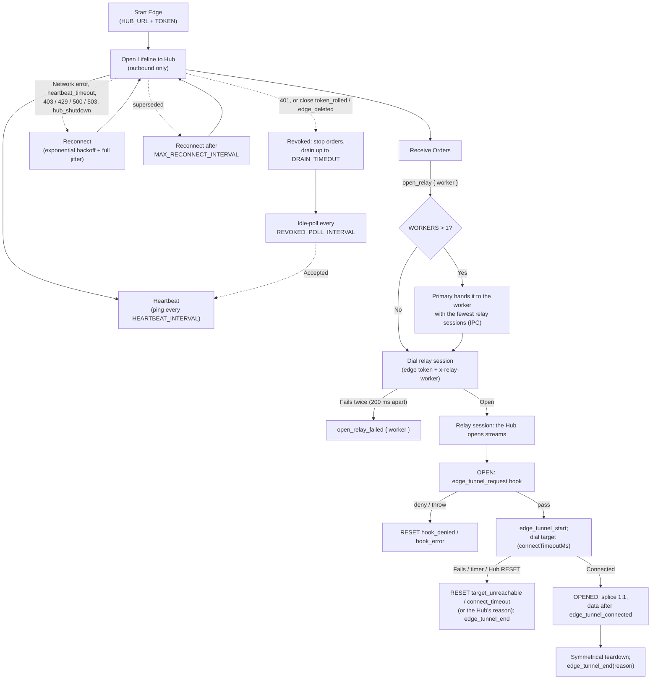

# Edge



## Role

The Edge is selected when `HUB_URL` is set. It runs inside a private network, never listens on any port, and only makes outbound connections to the Hub (typically `wss://` on 443 through the Hub's TLS proxy). It has no storage or KV dependencies. All settings are in the [Configuration Reference](configuration.md#edge-settings).

```bash
# Single process
node src/main.ts --hub-url wss://tunnels.example.com --token edg_a1c2e3d4...

# Multi-worker
HUB_URL="wss://tunnels.example.com" TOKEN="edg_a1c2e3d4..." WORKERS=4 node src/main.ts
```

Run exactly one daemon per edge token. A second daemon with the same token replaces the first (`superseded`), and the two keep replacing each other.

---

## Lifeline

### Heartbeat

The Edge runs the [bidirectional heartbeat](../1-concepts/protocol-spec.md#3-heartbeat-all-websocket-connections) on its lifeline and on every relay session. A lifeline that receives nothing for `HEARTBEAT_TIMEOUT` is terminated (`heartbeat_timeout`) and the Edge reconnects.

### Reconnection

Reconnect delays follow `min(MAX_RECONNECT_INTERVAL, RECONNECT_INTERVAL * 2^attempt)` with full jitter (uniform between 0 and that value). The Edge also enters this loop when the Hub is unreachable at startup. The attempt counter resets once a lifeline has stayed up for one `HEARTBEAT_INTERVAL`.

How each lifeline outcome is handled follows the [Client Retry Policy](../1-concepts/protocol-spec.md#client-retry-policy):

| Outcome                                                                         | Behavior                                                                                                           |
| :------------------------------------------------------------------------------ | :----------------------------------------------------------------------------------------------------------------- |
| Network error, timeout, `500`, `503`, `heartbeat_timeout`, close `hub_shutdown` | Normal backoff.                                                                                                    |
| `429`                                                                           | Wait `Retry-After` if present, otherwise normal backoff.                                                           |
| `403`                                                                           | Backoff jumps to `MAX_RECONNECT_INTERVAL`.                                                                         |
| Close `superseded`                                                              | Log a warning (another daemon or a newer connection uses this token) and reconnect after `MAX_RECONNECT_INTERVAL`. |
| `401`, close `token_rolled` / `edge_deleted`                                    | Enter the revoked state.                                                                                           |

### Revocation Handling

In the revoked state the Edge:

1. Logs `Edge token revoked` at `warn` (repeated on every poll).
2. Stops accepting orders.
3. Lets in-flight streams finish for up to `DRAIN_TIMEOUT` (default 30s), then resets the rest and closes its relay sessions. When revocation comes from a token roll or deletion, the Hub also closes those sessions itself (`token_rolled` / `edge_deleted`), so draining is only a safety net.
4. Stays alive and retries the lifeline every `REVOKED_POLL_INTERVAL` (default 300s).
    - **With `TOKEN_FILE`**: the Edge re-reads the token from the file on disk before each lifeline attempt, including every poll. In Kubernetes/Docker secrets environments, updating the secret file allows the daemon to automatically recover without restarting the pod or container!
    - **With static `TOKEN`**: the poll acts as a quiescent keep-alive so container supervisors (e.g. `restart: always`) do not enter aggressive restart crash loops. Restart the daemon with the new token to resume.

A rejected relay session dial (`401` included) is retried once and then reported with `open_relay_failed`, which fails only the streams waiting for that session (`relay_dial_failed`); it never affects the lifeline.

### Orders

The order formats (`open_relay`, `open_relay_failed`) are defined in the [Protocol Spec](../1-concepts/protocol-spec.md#2-lifeline-protocol). The lifeline never carries tunnel data. The Edge has no timeout setting of its own; every stream's `OPEN` carries `connectTimeoutMs`.

---

## Relay Sessions

For each `open_relay { worker }` order (ignored in the revoked state), the Edge dials a relay session to `HUB_URL`, presenting its edge token (re-read from `TOKEN_FILE` on every dial) and `x-relay-worker: <worker>`. A failed dial is retried once after 200 ms; when both fail, the Edge sends `open_relay_failed { worker }` on its lifeline.

The Hub decides how many relay sessions the Edge holds and when they close (see [Warden](../3-subsystems/warden.md#2-relay-sessions)); the Edge only dials what it is asked for. Each session runs the heartbeat and accepts up to `MAX_STREAMS_PER_RELAY` (256) streams at once; an `OPEN` beyond that is answered `RESET stream_limit`.

---

## Stream Setup and Splicing

For each stream the Hub opens on a relay session (`OPEN` with a [`RelayStreamOpen`](../1-concepts/protocol-spec.md#c-relay-sessions) payload; an invalid payload is answered `RESET stream_error`):

1. **Gate**: run `edge_tunnel_request(context, tunnel)`. `context.deny()` answers `RESET hook_denied`; a throw or `HOOK_TIMEOUT` answers `RESET hook_error`. No socket is opened, and neither `edge_tunnel_start` nor `edge_tunnel_end` fires. A stream the Hub reset (or whose relay session closed) while the gate was running is dropped right after it the same way: no dial, no `edge_tunnel_start`, no `edge_tunnel_end`.
2. **Start and dial**: dispatch `edge_tunnel_start(context, tunnel)` and dial the target at `internalHost:internalPort` (`noDelay`), with a timer of `connectTimeoutMs`. The target socket is paused as soon as it connects, so its greeting waits for the splice, and uses TCP keepalive.
3. **Dial failure**: a dial error answers `RESET target_unreachable` (`ECONNREFUSED`, `EHOSTUNREACH`, `ENETUNREACH`, DNS failure) or `RESET connect_timeout` (any other error). When the timer fires first, `edge_tunnel_timeout` fires and the answer is `RESET connect_timeout`. A `RESET` from the Hub during the dial (the runtime stream ended, or the Hub's deadline passed) drops the dial with the Hub's reason. Each case fires `edge_tunnel_end` with its reason.
4. **Splice**: answer `OPENED` and splice the stream 1:1 to the target socket. Data flows once `edge_tunnel_connected(context, tunnel, remoteSocket, targetSocket)` settles (bounded by `HOOK_TIMEOUT`), so byte-counting listeners see every byte.
5. **Teardown**: when either side ends or errors, both close (no half-close) and `edge_tunnel_end(context, tunnel, reason, error?)` fires exactly once.

```typescript
import { spliceStreams } from "../mux/splice.ts";

stream.opened(); // OPENED: the Hub splices the runtime stream to this one
const teardown = spliceStreams({
    stream, // the Hub's stream on the relay session
    other: targetSocket,
    streamEnd: "client_close", // the Hub's FIN, or a RESET reason outside the taxonomy
    otherEnd: "target_close", // the target's FIN
    ready: runAwaitedHook("edge_tunnel_connected", context, tunnel, stream, targetSocket), // bounded, fail-open
    onEnd: (reason, error) => dispatchTelemetry("edge_tunnel_end", context, tunnel, reason, error), // not awaited
});
```

The splice is the same one the Hub uses between a runtime stream and its target: a `FIN` carries the last bytes over and then both sides close; a `RESET` or a socket error ends both with its reason (a `RESET` from the Hub with a taxonomy reason is reported verbatim, a socket error as `stream_error`), and the teardown resets the Hub's stream with that reason so it reaches the runtime.

---

## Multi-Worker Mode

With `WORKERS > 1` the Edge runs a Primary and workers on one host:

- **Primary**: holds the single lifeline and the heartbeat. It counts the relay sessions each worker holds and hands each `open_relay` order to the worker with the fewest; with no worker available it answers `open_relay_failed` itself.
- **Workers**: dial relay sessions, and for every stream on them run `edge_tunnel_request`, dial the target, splice, and emit the `edge_tunnel_*` hooks.

IPC messages (all use the `type` discriminator):

| `type`              | Direction        | Payload                 | Purpose                                                                                                                  |
| :------------------ | :--------------- | :---------------------- | :----------------------------------------------------------------------------------------------------------------------- |
| `open_relay`        | Primary → worker | `{ worker }`            | Dial a relay session to the Hub worker `worker`.                                                                         |
| `relay_opened`      | worker → Primary | none                    | A relay session is up; the worker's count goes up.                                                                       |
| `relay_closed`      | worker → Primary | none                    | A relay session closed; the worker's count goes down.                                                                    |
| `open_relay_failed` | worker → Primary | `{ worker }`            | Both dials failed; the Primary forwards the frame on the lifeline.                                                       |
| `drain_sessions`    | Primary → worker | `{ timeoutMs, reason }` | Revoked state: let streams finish for up to `timeoutMs` (`DRAIN_TIMEOUT`), then reset the rest and close relay sessions. |

**Worker crash**: the Primary forks a replacement. The relay sessions of the dead worker drop with it, which ends their streams on the Hub; the Hub asks for new sessions as streams need them.

**Primary crash**: the whole daemon exits; restart it with a process supervisor.

---

## Shutdown

On `SIGINT` / `SIGTERM` the Edge closes its lifeline with `1001 edge_shutdown`, stops accepting orders, lets streams finish for up to `SHUTDOWN_TIMEOUT`, resets the remaining ones with `edge_shutdown`, closes its relay sessions with `1001 edge_shutdown`, and exits. The relay sessions stay open during the drain and the Hub does not know the Edge is leaving (relay sessions do not depend on the lifeline), so it keeps opening new streams on them; the Edge serves those too, and any still open at the end are reset with `edge_shutdown`.

In multi-worker mode the Primary closes the lifeline and forwards the signal to every worker; each worker drains its own streams and relay sessions the same way and exits. The Primary exits once all workers have exited, or `SHUTDOWN_TIMEOUT + 5s` after the signal at the latest.

---

## Hooks

The Edge emits `edge_tunnel_request` (gating), `edge_tunnel_start`, `edge_tunnel_connected`, `edge_tunnel_timeout`, and `edge_tunnel_end` (telemetry). Signatures, failure policies, and where each runs are in the [Hooks Catalog](../4-extensibility/hooks.md). The Edge does not count bytes or track durations by default.
