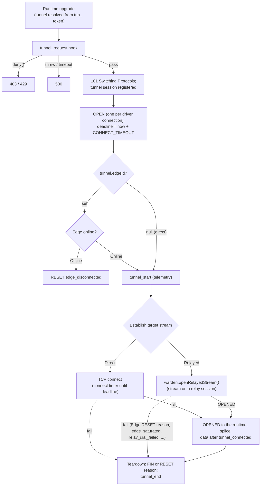

# Tunnel Handler



## Overview

The Tunnel Handler owns the lifecycle of every tunnel session a runtime opens and of every stream on it: gating, the direct dial or the relayed stream, splicing, revocation, and teardown. A tunnel session is one WebSocket, authenticated and gated once at the upgrade; every driver connection the runtime makes is a stream on it ([Data Framing](../1-concepts/protocol-spec.md#4-data-framing)). The runtime keeps a pool of sessions per registered tunnel and opens more when they are busy. The handler does not count bytes or measure durations; that is left to [telemetry hooks](../4-extensibility/extending-monitoring.md).

## Session Lifecycle

1. **Gate**: `tunnel_request(req, tunnel)` runs once, before the upgrade. `req.deny()` rejects with the hook's status (default `403`); a throw or `HOOK_TIMEOUT` rejects with `500`.
2. **Accept**: `wss.handleUpgrade(req, socket, head, ...)` sends `101`. The WebSocket becomes a tunnel session (`MuxSession`, at most 256 streams at once, `RESET stream_limit` beyond), joins the heartbeat sweep, and is registered (see [Session Registry](#session-registry)).
3. **Stream**: each `OPEN` from the runtime starts a stream with a request of its own (`id` is `<session id>.<stream id>`, plus `muxStreamId` and `openedAt`; plain-object fields are copied so hooks can annotate one stream without touching the others). The stream is paused, so early driver bytes (e.g. a PostgreSQL `StartupMessage`, sent as `DATA` before `OPENED`) wait in its buffer. The deadline is set to `now + CONNECT_TIMEOUT`.
4. **Liveness** (relayed tunnels only): verified from [presence](warden.md#presence). If the Edge has no live lifeline, the stream is answered `RESET edge_disconnected` (`stream_error` when KV is unavailable); no `tunnel_start` / `tunnel_end` fire.
5. **Start**: dispatch `tunnel_start(req, tunnel)`. From here on `tunnel_end` fires exactly once for the stream, whatever ends it (failure, teardown, revocation, or shutdown).
6. **Target stream**:
    - **Direct**: `net.createConnection({ host: internalHost, port: internalPort })`, bounded by a plain timer that fires at the deadline, destroys the socket, and is cleared on `connect`. `socket.setTimeout()` is never used for this (it is an idle timeout). The target socket is paused on connect and uses TCP keepalive.
    - **Relayed**: `warden.openRelayedStream(tunnel, req, deadline, signal)` opens a stream on one of the Edge's [relay sessions](warden.md#3-relayed-streams) and resolves with it once the Edge answered `OPENED` (target connected), or rejects with a taxonomy reason (see [Relayed Failure Reason Sources](../1-concepts/protocol-spec.md#d-relayed-failure-reason-sources)), including `edge_saturated` when the chosen relay session is full.
    - Any failure answers the runtime's stream `RESET` with the reason and fires `tunnel_end` with it.
    - If the runtime ends the stream first, it ends with `client_aborted` (or the runtime's `RESET` reason): a direct dial is destroyed; for relayed tunnels the Warden sends `RESET` with that reason on the relay stream, so the Edge drops its dial.
    - If the session is severed (see [Session Registry](#session-registry)) or the Hub shuts down before the target stream is ready, the stream ends with that reason and the late target stream, if any, is destroyed.
7. **Splice**: answer `OPENED`, then splice the runtime's stream 1:1 to the target socket (direct) or relay stream (relayed). Data flows once `tunnel_connected(req, tunnel, remoteSocket, targetSocket)` settles (bounded by `HOOK_TIMEOUT`), so hooks observe every byte.
8. **Teardown**: the first side to end or fail determines the reason. A `FIN` from either side carries the last bytes over, then both close (`client_close` when the runtime ended, `target_close` when the target did); a `RESET` carries its reason, propagated verbatim when it is a taxonomy reason (for relayed tunnels, e.g. `stream_error` when the target socket failed on the Edge); a socket error is `stream_error`. The runtime's stream is reset with that reason and `tunnel_end` fires with it, plus the underlying `Error` if any. Close codes from `CLOSE_CODES[reason]` ([Protocol Spec](../1-concepts/protocol-spec.md#5-close-codes)) apply when a whole tunnel session closes (revocation, heartbeat, shutdown), which ends every stream on it with the close reason.

```typescript
// src/tunnels/splicing.ts: the Hub's side of a stream, once the target stream is ready
stream.opened(); // OPENED to the runtime
spliceStreams({
    stream, // the runtime's stream on its tunnel session
    other: targetStream, // the target socket, or the stream on the Edge's relay session
    streamEnd: "client_close", // the runtime's FIN, or a RESET reason outside the taxonomy
    otherEnd: "target_close", // the target's FIN
    ready: runAwaitedHook("tunnel_connected", req, tunnel, stream, targetStream), // bounded, fail-open
    onEnd: (reason, error) => dispatchTelemetry("tunnel_end", req, tunnel, reason, error), // not awaited
});
```

`spliceStreams` (`src/mux/splice.ts`) is shared with the Edge. It returns an idempotent teardown that resets both sides with the reason; a burst of small `DATA` frames is corked into one write to the target.

## Session Registry

Each worker keeps an in-memory index of its active tunnel sessions by `tunnelId` and by `edgeId`. It exists so that revocation takes effect immediately:

| Trigger                                                    | Tunnel sessions closed (with every stream on them) | Code / reason         |
| :--------------------------------------------------------- | :------------------------------------------------- | :-------------------- |
| Tunnel token rolled                                        | All sessions of that tunnel                        | `1000 token_rolled`   |
| Tunnel deleted                                             | All sessions of that tunnel                        | `1000 tunnel_deleted` |
| Tunnel `internalHost`, `internalPort`, or `edgeId` changed | All sessions of that tunnel                        | `1000 tunnel_updated` |
| Edge token rolled                                          | All sessions relayed through that Edge             | `1000 token_rolled`   |
| Edge deleted (tunnels cascade)                             | All sessions of its tunnels                        | `1000 edge_deleted`   |

The REST API applies the change in storage first, evicts caches, and then broadcasts `sever_sessions { tunnelId | edgeId, reason }`. In clustered mode the broadcast goes through the Primary to every worker. Changes to `name` or `metadata` do not close sessions.

**Sever memory**: an upgrade resolves its token, then runs its gating hooks, then registers its session; a sever that runs in between would miss it, and the session would live on with the old entity. So every worker remembers each sever (tunnel id or Edge id, reason, time) for `SEVER_MEMORY_MS` (5 minutes), and the upgrade records when its token started resolving (`req.resolvedAt`, wall-clock, comparable across workers). A tunnel session whose tunnel or Edge was severed since then is closed at once with that sever's reason, before it registers; so is a lifeline or relay session whose Edge was (see [Warden](warden.md#edge-token-roll-and-deletion)). An upgrade that took longer than `SEVER_MEMORY_MS` to set up cannot be checked and is closed with `stream_error`. A sever of an Edge on a worker also closes its lifeline and relay sessions there.

### Programmatic Session Severing API

In addition to REST-triggered mutations, the Hub exports a programmatic API allowing plugins, background subscribers, or custom event handlers (such as external revocation webhooks or message queue listeners) to immediately terminate active sessions matching a filter:

```typescript
/**
 * Programmatically severs active sessions across all workers matching the filter.
 * In clustered mode, broadcasts sever_sessions through the Primary to all workers.
 *
 * @param filter An object containing tunnelId, edgeId, or both.
 * @param reason The close taxonomy reason to report (default: "token_rolled").
 * @returns Number of sessions severed on this worker (other workers' counts are not collected).
 */
export async function severSessions(
    filter: { tunnelId?: string; edgeId?: string },
    reason: Reason = "token_rolled"
): Promise<number>;
```

Example usage in an external event subscriber or plugin:

```typescript
import { severSessions } from "../src/tunnels/registry.ts";

// Terminate all sessions for a specific tunnel immediately
const count = await severSessions({ tunnelId: "tun-uuid-1234" }, "token_rolled");
console.log(`Severed ${count} active session(s) on this worker`);
```

## Hooks

`tunnel_request`, `tunnel_start`, `tunnel_connected`, and `tunnel_end`. Signatures and policies are in the [Hooks Catalog](../4-extensibility/hooks.md).
