# Warden

```mermaid
flowchart TD
    subgraph L["1. Lifelines"]
        EdgeConn["Lifeline upgrade (edg_ token)"] --> Resolve["Resolve edge (cache / storage)"]
        Resolve --> Gate["lifeline_connect hook"]
        Gate --> Accept["101; replace any older lifeline (superseded)"]
        Accept --> Presence["Presence written to KV once per sweep"]
        Accept --> Warm["open_relay for this worker\n(one warm relay session)"]
    end

    subgraph R["2. Relay Sessions"]
        RelayConn["Relay session upgrade\n(edg_ token + x-relay-worker)"] --> RGate["Resolve edge; lifeline_connect hook"]
        RGate --> Same{"Named worker?"}
        Same -->|"Yes"| Register["Upgrade; register in this worker's pool"]
        Same -->|"No"| Move["Move raw socket via Primary\nto the named worker"] --> Register
    end

    subgraph S["3. Relayed Streams"]
        Req["openRelayedStream(tunnel, req, deadline, signal)"] --> Pick{"Relay session\nof the Edge here?"}
        Pick -->|"No"| Ask["open_relay via the lifeline worker;\nwait until deadline"] --> Pick
        Pick -->|"Yes"| Open["OPEN { reqId, tunnel, client, connectTimeoutMs }"]
        Open --> Result["OPENED: stream spliced\nRESET: Edge's reason"]
    end
```



## Overview

The Warden runs inside the Hub. It manages Edge lifelines and presence, keeps the pool of relay sessions each Edge holds to each Hub worker, places relayed streams on them, and, in clustered mode, routes relay requests to the lifeline worker and moves relay session sockets to the worker they were dialed for. Terms are defined in the [Glossary](../1-concepts/glossary.md); wire formats in the [Protocol Spec](../1-concepts/protocol-spec.md#2-lifeline-protocol).

---

## 1. Lifelines

When an upgrade presents an edge token without an `x-relay-worker` header:

1. **Resolve**: look the edge up by token through the [entity cache](entity-schemas.md#token-resolution--cache). Unknown token: `401`. Storage or KV unavailable: `503`.
2. **Gate**: run `lifeline_connect(req, edge)`. `req.deny()` rejects with the hook's status (default `403`); a throw or `HOOK_TIMEOUT` rejects with `500`. Neither puts the Edge in its revoked state.
3. **Accept** the upgrade and add the lifeline to the heartbeat sweep. If KV fails during the steps below (Redis down while reading `edge:<id>:worker`), the error is logged and the lifeline is closed with `1011 stream_error` before it is registered (no `lifeline_disconnect`); the Edge dials again with its backoff. A failed presence write in step 6 is only logged.
4. **Newest wins**: if this Edge already has a lifeline (on this worker, or on another worker according to `edge:<id>:worker`), the older one is closed with `1000 superseded`. The older lifeline's cleanup never unregisters the newer lifeline or its presence. In clustered mode the new lifeline worker sends `close_lifeline { edgeId, reason: "superseded" }` to the old worker through the Primary.
5. **Version**: if the `version` header differs from `edge.version`, the stored value is updated (asynchronously). The field is informational and read-only through the REST API.
6. **Register**: `edgeLifelines.set(edge.id, ws)`, write presence immediately (below), and `SADD worker:<bootId>:<workerId>:edges <edgeId>`.
7. **Warm relay session**: if the Edge has no relay session on this worker, write `open_relay` for this worker, so the first stream does not wait for the Edge's dial. The lifeline worker keeps that session open while it holds the lifeline (see [Idle Sessions](#idle-sessions)).

The lifeline worker writes every `open_relay` for the Edge, its own and those other workers ask for (see [Requesting a Session](#requesting-a-session)). When the Edge answers `open_relay_failed { worker }`, the lifeline worker fails its own waiting streams with `relay_dial_failed` when `worker` is itself, and otherwise sends `relay_failed` to `worker`.

### Presence

Presence lets any worker, and `GET /edges`, know whether an Edge is online:

| Key                       | Value                                   | TTL                           | Written                                                                         |
| :------------------------ | :-------------------------------------- | :---------------------------- | :------------------------------------------------------------------------------ |
| `edge:<edgeId>:worker`    | Worker identity `<bootId>:<workerId>`   | `2 * HEARTBEAT_TIMEOUT` (60s) | On accept, then refreshed once per heartbeat sweep while the lifeline is alive. |
| `edge:<edgeId>:last_seen` | Unix seconds of the last presence write | 30 days (rolling)             | On accept, then once per heartbeat sweep.                                       |

Presence is written once per sweep per lifeline, never per pong, so KV load is three writes per Edge per `HEARTBEAT_INTERVAL` (`SET edge:<id>:worker`, `SET edge:<id>:last_seen`, `SADD worker:<identity>:edges`). `last_seen` is the time of the sweep, so it can be later than the last frame actually received by up to one `HEARTBEAT_TIMEOUT`.

An Edge is **online** when `edge:<id>:worker` exists and its `bootId` equals the current Hub's `bootId`. Because `bootId` changes on every Hub start, mappings left in Redis by a previous run are never mistaken for live lifelines.

### Heartbeat and Disconnect

The lifeline runs the [bidirectional heartbeat](../1-concepts/protocol-spec.md#3-heartbeat-all-websocket-connections). When a lifeline closes for any reason (heartbeat timeout, Edge disconnect, supersede, revocation, shutdown), the lifeline worker:

1. Removes it from `edgeLifelines` (only if it is still the registered lifeline for that Edge).
2. Unless a newer lifeline for the same Edge is registered on this worker, runs `delIfEquals("edge:<id>:worker", "<bootId>:<workerId>")`, so a newer lifeline registered elsewhere is never unregistered, and `SREM worker:<bootId>:<workerId>:edges <edgeId>`.
3. Unless a newer lifeline replaced it on this worker, fails the streams on this worker that wait for a relay session of that Edge with `edge_disconnected` (or `hub_shutdown` when that was the close reason): no relay session will be dialed on their behalf any more. Streams waiting for a relay session of that Edge on other workers are not told: they fail at their deadline with `connect_timeout`.
4. Dispatches `lifeline_disconnect(null, edge, reason)` with the lifeline's close reason. When the Hub closed the lifeline, this is the reason the Hub sent (`heartbeat_timeout`, `superseded`, `token_rolled`, `edge_deleted`, `hub_shutdown`), even if the Edge never answered the close handshake; when the Edge closed it, the Edge's reason if it is a taxonomy reason (e.g. `edge_shutdown`), otherwise `client_close`.

Relay sessions and the streams they carry do not depend on the lifeline and keep running; without a lifeline the worker no longer keeps a warm session, so idle ones close (see [Idle Sessions](#idle-sessions)).

---

## 2. Relay Sessions

Each Hub worker keeps, per Edge, a pool of the relay sessions that Edge dialed to it: WebSockets carrying many streams, each opened by the Hub for one runtime stream (framing in the [Protocol Spec](../1-concepts/protocol-spec.md#c-relay-sessions)). Edges sit on home networks, where streams sharing one WebSocket wait a round trip on each other, and a stream stays on its session for life (keep-alive connections carry many requests), so the pool gives each new stream its own session while it can.

### Requesting a Session

A worker asks the Edge for a session (`requestRelay`) when a stream finds none, when a stream finds every session busy or takes the last idle one (see [Placement](#placement)), when its lifeline connects, and when its last session closes while streams wait or while it holds the Edge's lifeline:

- **Lifeline on this worker**: write `open_relay { worker: <this worker> }` on it.
- **Clustered, lifeline elsewhere**: read `edge:<id>:worker` and send `relay_request { edgeId, worker }` through the Primary to the lifeline worker, which writes `open_relay { worker }`. A lifeline worker that no longer holds the lifeline answers `relay_failed { reason: "edge_disconnected" }`.
- **No lifeline at all** (single process, or no presence): the waiting streams fail with `edge_disconnected`. KV unavailable while reading presence: `stream_error`.

Requests run in parallel: a burst of new streams asks for as many sessions at once. Sessions up plus requests outstanding (each counted for 10 seconds, or until a session comes up or a failure is reported) never exceed `MAX_RELAY_SESSIONS` (64) per Edge per worker. The lifeline connecting always sends one.

### Accepting a Session

A relay session is an upgrade presenting an edge token and `x-relay-worker: <worker identity>`:

1. **Resolve and gate** exactly like a [lifeline](#1-lifelines): unknown token `401`, storage or KV unavailable `503`, then `lifeline_connect(req, edge)`, whose denial or failure rejects the upgrade. The Edge retries a rejected dial once, then reports `open_relay_failed`.
2. **Route**: if `x-relay-worker` names another worker (clustered mode), the raw socket is moved to it through the Primary without completing the handshake (see [Clustered Relay Sessions](#4-clustered-relay-sessions)). Otherwise the upgrade completes here.
3. **Register**: the session joins the Edge's pool on this worker and runs the heartbeat. The oldest stream waiting for a spare (see [Placement](#placement)) takes it; streams waiting for any session of that Edge wake up.

### Placement

`placeStream(edgeId, deadline)` chooses the session for a new stream and reserves it until the stream's `OPEN` is written (so a burst of streams does not all pick the same idle session):

1. **Lightest**: among the open sessions that are neither clogged nor at `MAX_STREAMS_PER_RELAY` (256) streams, the one with the fewest streams (reservations included; ties: the fewest bytes waiting to go out). When all are clogged or full, the lightest of all. No session yet: ask for one and wait for it, until the deadline.
2. **Idle**: the stream takes it. If it was the last idle session, ask the Edge for a spare ahead of the next stream.
3. **Every session busy**: while `MAX_RELAY_SESSIONS` (64) allows, ask the Edge for one more and wait for it up to `SPARE_WAIT_MS` (1 s, within the deadline): the stream takes the next session to come up. When none comes in time, or the cap is reached, it shares the lightest session.

A session is **clogged** while any of these holds:

| Criterion   | Threshold                                                                                                                                 |
| :---------- | :---------------------------------------------------------------------------------------------------------------------------------------- |
| Streams     | 32 streams on the session.                                                                                                                |
| Queued data | More than 512 KiB waiting to go out on the WebSocket for over 50 ms.                                                                      |
| Round trip  | Smoothed round trip over `2 x` the session's best + 20 ms (measured with a tagged `ping` every second while the session carries streams). |

These limits are constants, not settings.

### Idle Sessions

Every 5 seconds the worker closes sessions that carried no stream for 30 seconds (`RELAY_IDLE_MS`). The Edge's last session on the worker is kept while this worker holds the Edge's lifeline (the warm session), and otherwise closed after `4 x RELAY_IDLE_MS` (2 minutes).

---

## 3. Relayed Streams

`openRelayedStream(tunnel, req, deadline, signal)` is called by the [Tunnel Handler](tunnel-handlers.md) for each stream of a relayed tunnel, after the Edge was found online:

1. **Session**: `placeStream` (see [Placement](#placement)); when the Edge has none on this worker, it requests one and waits until one is up. The wait fails at `deadline` (`connect_timeout`), on `signal` (its abort reason: the runtime stream ended or was severed), or with the reported failure (`relay_dial_failed`, `edge_disconnected`, `target_worker_dead`, `stream_error`, `hub_shutdown`, or the sever reason). If no session is there once woken: `relay_dial_failed`.
2. **Saturation**: the chosen session already carries `MAX_STREAMS_PER_RELAY` (256) streams: `edge_saturated`.
3. **Open**: `connectTimeoutMs = deadline - Date.now()` (not positive: `connect_timeout`, nothing sent), then `OPEN` with the `RelayStreamOpen` payload `{ reqId, tunnel: { id, name, internalHost, internalPort, metadata }, client: { ip, correlationId }, connectTimeoutMs }`.
4. **Outcome**:
    - **`OPENED`**: resolves with the relay stream (a `Duplex`), which the Tunnel Handler splices 1:1 to the runtime stream.
    - **`RESET` from the Edge**: fails with the Edge's reason, verbatim. A reason outside the taxonomy, or `client_close`, is reported as `stream_error`, or `edge_disconnected` when the relay session itself closed.
    - **Relay session closed before `OPENED`**: fails with the reason this side closed it with (`heartbeat_timeout`, `hub_shutdown`, a sever reason), or the Edge's close reason, else `edge_disconnected`. A relay session the Edge drops without a taxonomy reason ends its opened streams with `target_close`, but a stream still waiting for `OPENED` never reached a target, so it reports `edge_disconnected`.
    - **Deadline**: fails with `connect_timeout` and sends `RESET connect_timeout` to the Edge, which drops its dial.
    - **Abort** (`signal`): fails with the abort reason and sends `RESET` with it to the Edge.

The Edge's side of each stream (gate, target dial, splice) is described in [Edge](../2-nodes/edge.md#stream-setup-and-splicing).

---

## 4. Clustered Relay Sessions

Node.js workers share no memory and cannot message each other directly; all IPC goes through the Primary. Only the lifeline worker can send orders to an Edge, and a relay session upgrade arrives on whichever worker the OS hands the connection to, so requests are routed to the lifeline worker and sockets are moved to the worker they were dialed for. Moving a socket requires plain TCP sockets, which is why TLS is always terminated by a reverse proxy in front of the Hub (see [Configuration](../2-nodes/configuration.md#deployment-requirement-tls)).

```mermaid
sequenceDiagram
    autonumber
    participant A as Worker A (stream)
    participant P as Primary
    participant B as Lifeline Worker B
    participant Edge as Edge
    participant C as Receiving Worker C

    A->>A: No relay session of the Edge here; stream waits (until deadline)
    A->>P: relay_request { edgeId, worker: A }
    P->>B: forward
    B->>Edge: open_relay { worker: A } (lifeline)
    Edge->>C: Relay session upgrade (edge token, x-relay-worker: A)
    C->>C: Resolve edge, lifeline_connect (handshake not completed)
    C->>P: relay_session_socket { edgeId, head, headers } + raw socket
    P->>A: forward message + raw socket
    A->>A: handleUpgrade(reqAdapter, socket, head); register; wake the stream
    A->>Edge: OPEN { reqId, tunnel, client, connectTimeoutMs }
    Edge-->>A: OPENED (or RESET reason)
```

Migration details:

- The receiving worker does not complete the handshake; it forwards the request headers and the already-read `head` bytes with the socket. The socket is not paused at that point (the HTTP server resumes it once `hub_upgrade` passes), but the Edge sends nothing before the `101`, so no bytes are lost.
- The Primary and workers use IPC `serialization: "advanced"`, so `head` arrives as a `Buffer`. The named worker passes it as the third argument of `wss.handleUpgrade` and never calls `socket.unshift`.
- The named worker builds a minimal `IncomingMessage`-compatible adapter (`method`, `url: "/"`, `headers`, `socket`) for `ws`.

### IPC Messages

All messages carry `type` and `target` (worker identity).

| `type`                 | Route                               | Payload                              | Purpose                                                                                                                               |
| :--------------------- | :---------------------------------- | :----------------------------------- | :------------------------------------------------------------------------------------------------------------------------------------ |
| `relay_request`        | worker → lifeline worker            | `{ edgeId, worker }`                 | Write `open_relay { worker }` on the Edge's lifeline; answered with `relay_failed` (`edge_disconnected`) when there is none.          |
| `relay_failed`         | lifeline worker or Primary → worker | `{ edgeId, reason? }`                | Fail the streams waiting for a relay session of that Edge with `reason` (default `relay_dial_failed`).                                |
| `relay_session_socket` | receiving worker → named worker     | `{ edgeId, head, headers }` + socket | Move a relay session socket to the worker named in `x-relay-worker`.                                                                  |
| `close_lifeline`       | any → lifeline worker               | `{ edgeId, reason }`                 | Close a lifeline (`superseded`, `token_rolled`, `edge_deleted`).                                                                      |
| `sever_sessions`       | any → all workers                   | `{ tunnelId?, edgeId?, reason }`     | Revocation broadcast (see [Session Registry](tunnel-handlers.md#session-registry)); with an `edgeId`, also closes its relay sessions. |

### Dead Workers

The Primary initializes the same KV provider as the workers (Redis, or the shared file KV in test mode) so that it can clean up after them.

When the Primary cannot deliver a message because the target worker is gone:

- A moving socket is destroyed; the Edge's dial fails and it reports `open_relay_failed`.
- If the lifeline worker died: the Primary answers `relay_request` with `relay_failed { reason: "target_worker_dead" }` to the worker that asked, whose waiting streams fail with it.

When a worker exits, the Primary forks a replacement and cleans up that worker's presence:

```typescript
cluster.on("exit", async (worker) => {
    const identity = `${bootId}:${worker.id}`;
    const edgeIds = await kv.smembers(`worker:${identity}:edges`);
    for (const edgeId of edgeIds) {
        await kv.delIfEquals(`edge:${edgeId}:worker`, identity); // never removes a newer mapping
    }
    await kv.del(`worker:${identity}:edges`);
});
```

Sessions owned by the dead worker end when their sockets close, and so do the relay sessions it held (the Edge ends their streams). Edges whose lifelines were on it reconnect and land on another worker.

---

## Edge Token Roll and Deletion

1. The change is committed in storage, then the token cache is updated: on a roll the new token is cached and the old one is evicted and tombstoned; on deletion the edge's (and its tunnels') entries are evicted and tombstoned, and its presence keys are deleted. A roll leaves the presence keys in place.
2. The lifeline is closed with `1000 token_rolled` or `1000 edge_deleted` (via `close_lifeline` in clustered mode); `lifeline_disconnect` fires.
3. All sessions relayed through that Edge are closed with the same reason (via `sever_sessions`), and every worker closes the Edge's relay sessions with it; streams waiting for one fail with it too.
4. The Edge enters its [revoked state](../2-nodes/edge.md#revocation-handling). Further attempts with the old token get `401`.

On Hub shutdown, lifelines are closed with `1001 hub_shutdown` (streams still waiting for a relay session fail with `hub_shutdown`); relay sessions stay up while runtime sessions drain, then are closed with `1001 hub_shutdown`. Edges reconnect with backoff.

---

## Internal API

```typescript
/** Resolves with the relay stream once the Edge answered OPENED; rejects with a taxonomy reason. */
export function openRelayedStream(
    tunnel: Tunnel,
    req: IncomingMessageWithDeny,
    deadline: number,
    signal?: AbortSignal
): Promise<Duplex>;

/** Handles an upgrade presenting an edge token (after resolution), without x-relay-worker. */
export function wardenLifeline(
    req: IncomingMessageWithDeny,
    socket: Duplex,
    head: Buffer,
    edge: Edge
): Promise<void>;

/** Handles an upgrade presenting an edge token and x-relay-worker (after resolution). */
export function wardenRelaySession(
    req: IncomingMessageWithDeny,
    socket: Duplex,
    head: Buffer,
    edge: Edge
): Promise<void>;
```

Settings used by the Warden (`CONNECT_TIMEOUT`, `HEARTBEAT_*`, `WORKERS`, `REDIS_URL`) are described in the [Configuration Reference](../2-nodes/configuration.md). The relay session pool limits above are constants.
