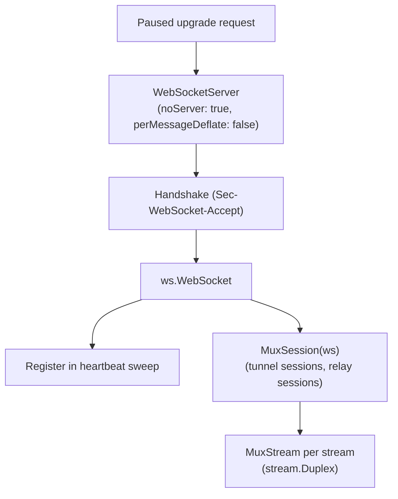

# WebSocket Server & Duplex Streams

## Overview

The WebSocket server has no listening port of its own. It completes upgrades handed over by the [HTTP Server](http-server.md), registers each connection in the heartbeat sweep, and runs the [stream framing](../1-concepts/protocol-spec.md#4-data-framing) on data connections (tunnel sessions and relay sessions), exposing each stream as a Node.js `stream.Duplex`. Lifelines are used as message channels and carry no streams.

> [!NOTE]
> Standard browser WebSockets do not support custom request headers like `Authorization` under the [WHATWG WebSocket API specification](https://websockets.spec.whatwg.org/), so direct browser WebSockets cannot supply the `Authorization` header required by the Hub and are rejected with `401 Unauthorized`.
>
> Inside the **FullStacked runtime**, `window.WebSocket` is overridden by FullStacked's `WebSocketCore`. Calling `tunnel.register({ host, authorization, name? })` from `fullstacked/tunnel` returns the generated string (or custom `name`). When you create your WebSocket with that tunnel name (`new window.WebSocket("ws://" + tunnelName)`), FullStacked's `WebSocketCore` routes the connection through the registered tunnel with the specified `authorization` credentials.

## Configuration

- `noServer: true`: upgrades come from the HTTP server.
- `perMessageDeflate: false`: tunneled bytes are often already compressed or encrypted; compression would cost CPU and memory for no gain.
- `maxPayload`: bounded (default of the `ws` library) so a single frame cannot exhaust memory.

## Streams

A `MuxSession` (`src/mux/`) wraps one WebSocket and carries many streams; either side can open them (the runtime on a tunnel session, the Hub on a relay session). Each stream is a `MuxStream`, a `stream.Duplex`:

| Stream side           | Frames                       | Behavior                                                                                                      |
| :-------------------- | :--------------------------- | :------------------------------------------------------------------------------------------------------------ |
| `stream.write(chunk)` | `DATA` (at most 32 KiB each) | Waits for the peer's credit (`WINDOW`) and for the WebSocket buffer to drain below 1 MiB.                     |
| `data` event          | `DATA` received              | Credit is returned to the peer (`WINDOW`) as the consumer reads.                                              |
| `stream.end()`        | `FIN`                        | The sender has no more bytes.                                                                                 |
| `stream.destroy()`    | `RESET`                      | Carries `stream.closeReason` (or `stream_error` / `client_close`); the peer's reason is in `peerCloseReason`. |

Closing the WebSocket ends every stream on it with the close reason. Streams are spliced so that the end of either direction ends both; half-close is not supported (see [Symmetrical Teardown](../1-concepts/protocol-spec.md#symmetrical-teardown-no-half-close)).

## Heartbeat

Every WebSocket accepted or opened by a process (lifelines, runtime sockets, relay sessions) is added to one shared sweep timer that runs the [bidirectional heartbeat](../1-concepts/protocol-spec.md#3-heartbeat-all-websocket-connections): it sends a `ping` every `HEARTBEAT_INTERVAL` and terminates connections that have received nothing for `HEARTBEAT_TIMEOUT` (`heartbeat_timeout`). No per-connection timers are allocated.

## Close Codes and Reasons

Close codes and the reason taxonomy are defined once, in the [Protocol Spec](../1-concepts/protocol-spec.md#5-close-codes). Only taxonomy strings are ever sent as close reasons, so the RFC 6455 limit of 123 bytes per reason is always respected without truncation.
