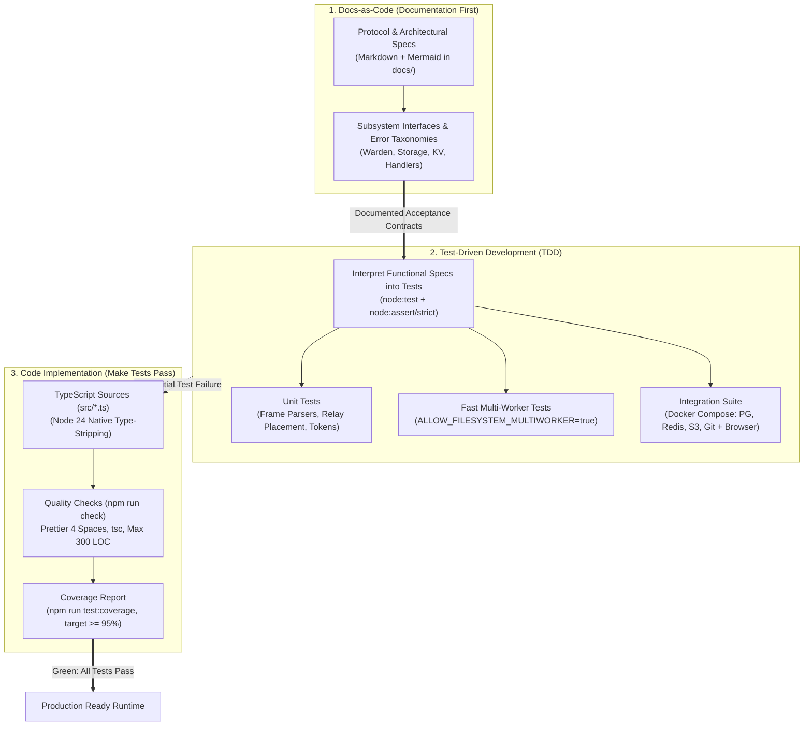
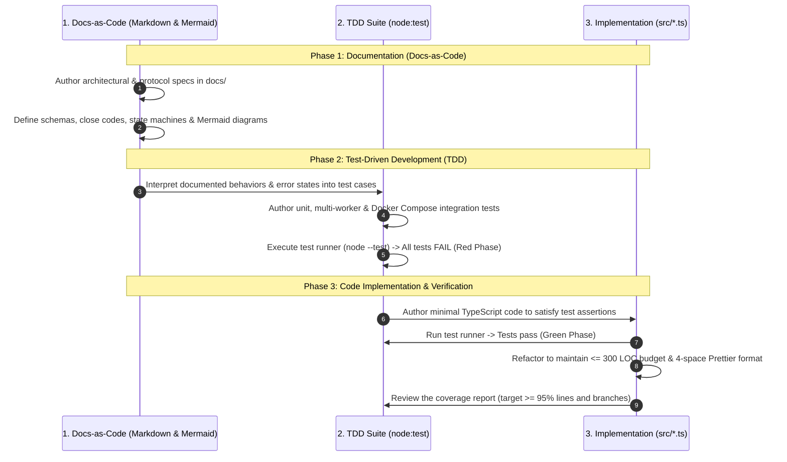

# Workflow & Tooling



## Overview

FullStacked Tunnels follows a disciplined, specification-first engineering methodology: **Docs-as-Code $\longrightarrow$ Test-Driven Development (TDD) $\longrightarrow$ Code Implementation**.

Development never begins by writing ad-hoc functional code. Instead, every protocol interaction, subsystem boundary, configuration option, and error mode is first fully documented in markdown specifications. Those specifications are then systematically interpreted into executable test suites (`node:test`) which initially fail. Finally, production TypeScript sources are authored to make the test suite pass, adhering to Node.js 24+ LTS native type stripping, Prettier formatting with 4 spaces, and a hard 300 LOC per file budget.

---

## 1. The Core Development Lifecycle



### Phase 1: Documentation (Docs-as-Code)

Every feature, protocol enhancement, or subsystem refactoring in FullStacked Tunnels **starts with documentation**:

1. **Specification as Single Source of Truth**:
    - Before any TypeScript implementation file is written or modified, the complete specification is authored in `docs/` using GitHub-flavored Markdown and Mermaid diagrams.
    - For protocol features: Define the exact frame structure, HTTP/WebSocket handshake headers, and error codes in [Protocol Spec](../1-concepts/protocol-spec.md).
    - For node topologies: Define the command-line flags, environment variables, and connection lifecycles in [Hub](../2-nodes/hub.md) and [Edge](../2-nodes/edge.md).
    - For subsystems: Define provider interfaces, data models, and operation pipelines in [Subsystems](../3-subsystems/tunnel-handlers.md).
2. **Deterministic Boundaries & Error Taxonomy**:
    - All failure scenarios, timeout windows, and edge cases must be cataloged in advance. Close codes must use exact entries from the [Close Reason Taxonomy](../1-concepts/protocol-spec.md#close-reason-taxonomy).
3. **Docs-as-Code**:
    - Technical documentation is maintained directly within the repository alongside code, with Mermaid diagrams embedded in the Markdown.

### Phase 2: Test-Driven Development (TDD) — Interpreting Docs into Tests

Once the documentation and architectural specifications are approved, **all defined functionalities are interpreted into tests**:

1. **Translating Specifications into Executable Contracts**:
    - Every requirement written in the documentation is directly mapped to a test case in `test/*.test.ts` or `test/integration/*.test.ts`.
    - Built on native Node.js tooling: `node:test` and `node:assert/strict` (zero third-party test framework overhead).
2. **Three-Tier Testing Hierarchy**:
    - **Unit Tests**: Test pure logic, binary frame parsers, relay session placement, and token validation.
    - **Fast Multi-Worker Tests (`ALLOW_FILESYSTEM_MULTIWORKER=true`)**: Test clustering, relay requests and raw relay session socket moves across worker processes via Primary IPC, and worker crash recovery in memory and filesystem without external database overhead.
    - **Zero-Mock Integration Tests**: Test real-world protocol interoperability against live containerized services via Docker Compose (PostgreSQL, Redis, MySQL, MongoDB, RustFS S3, Git server, HTTP/socket servers) and automated in-browser client testing via the `fullstackedorg/fullstacked` submodule.
3. **The Red Phase (Intentional Failure)**:
    - Tests are run _before_ the implementation code is written (`node --test`).
    - Because the functional implementation does not yet exist, the test suite initially fails. This confirms that the tests are actively testing the documented contracts and are not giving false positives.

### Phase 3: Code Implementation (Making the Test Suite Pass)

With the comprehensive test harness in place, the production code is authored:

1. **The Green Phase (Make Tests Pass)**:
    - Write TypeScript code in `src/*.ts` designed specifically to satisfy the failing test cases until the entire test suite passes.
2. **Architectural & Syntactic Compliance**:
    - Code must comply with Node.js 24 native type-stripping rules: no enums (use `const` maps + union types), no parameter properties in class constructors, mandatory `.ts` file extensions, and explicit `node:` module prefixes (see [Standards](standards.md)).
    - Every file must adhere to the hard budget of **maximum 300 LOC** (enforced by `scripts/check-loc.ts`). If a module reaches 250 LOC, it must be decomposed into focused single-responsibility submodules.
    - Formatting must adhere to Prettier with 4-space tab indentation (`npm run fmt:check`).
3. **The Refactor Phase & Coverage Verification**:
    - Clean up, optimize, and modularize code while maintaining passing tests.
    - Run the coverage report:
        ```bash
        npm run test:coverage
        ```
    - The target is **95% line and branch coverage**. It is a review target, not an automated gate: `test:coverage` sets no coverage threshold and the repository has no CI workflow.

---

## 2. Direct Node Execution

Node.js 24 LTS natively strips types from `.ts` files on the fly. No build step, file watcher, or transpile daemon is needed:

```bash
# Run Hub in development (port 3000, filesystem storage)
node src/main.ts --port 3000

# Run Edge (connecting to local Hub)
HUB_URL="ws://localhost:3000" TOKEN="edg_12345..." node src/main.ts
```

All source changes take effect immediately on process restart.

`TEST=1` is set by the test scripts for the `fullstackedorg/fullstacked` submodule used in integration tests (it disables its native webview); the server itself never reads it.

---

## 3. Automation Scripts (`package.json`)

The project uses standard scripts for all routine tasks:

```json
{
    "scripts": {
        "start": "node src/main.ts",
        "fmt": "prettier --write .",
        "fmt:check": "prettier --check .",
        "typecheck": "tsc --noEmit",
        "check:loc": "node scripts/check-loc.ts --max 300",
        "check": "npm run fmt:check && npm run typecheck && npm run check:loc",
        "test": "TEST=1 node --test test/*.test.ts",
        "test:coverage": "TEST=1 node --test --experimental-test-coverage test/*.test.ts",
        "test:integration": "node scripts/test-integration.ts"
    },
    "prettier": {
        "tabWidth": 4,
        "useTabs": false,
        "semi": true,
        "singleQuote": false,
        "trailingComma": "es5",
        "printWidth": 100,
        "arrowParens": "always"
    }
}
```

---

## 4. LOC Enforcement Script (`scripts/check-loc.ts`)

To ensure that the 300 LOC budget documented in [Standards](standards.md#2-file-size--loc-lines-of-code-budget) is respected, a zero-dependency script inspects all files:

```typescript
import fs from "node:fs";
import path from "node:path";

const MAX_LOC = parseInt(process.argv[3] || "300", 10);
const SRC_DIR = path.resolve(import.meta.dirname, "../src");

function countLoc(filePath: string): number {
    const content = fs.readFileSync(filePath, "utf-8");
    return content
        .split("\n")
        .map((line) => line.trim())
        .filter(
            (line) =>
                line.length > 0 &&
                !line.startsWith("//") &&
                !line.startsWith("/*") &&
                !line.startsWith("*")
        ).length;
}

function scanDir(dir: string): boolean {
    if (!fs.existsSync(dir)) return true;
    let ok = true;
    for (const entry of fs.readdirSync(dir, { withFileTypes: true })) {
        const fullPath = path.join(dir, entry.name);
        if (entry.isDirectory()) {
            if (!scanDir(fullPath)) ok = false;
        } else if (entry.isFile() && fullPath.endsWith(".ts")) {
            const loc = countLoc(fullPath);
            if (loc > MAX_LOC) {
                console.error(
                    `❌ [LOC Limit Exceeded] ${path.relative(process.cwd(), fullPath)}: ${loc} LOC (limit is ${MAX_LOC})`
                );
                ok = false;
            }
        }
    }
    return ok;
}

if (!scanDir(SRC_DIR)) {
    console.error(
        `\nPlease decompose files exceeding ${MAX_LOC} LOC according to docs/5-development/standards.md`
    );
    process.exit(1);
}
console.log(`✅ All source files in src are within the ${MAX_LOC} LOC limit.`);
```

---

## 5. Quality & Testing Practices

### A. Pre-Commit Quality Gate

No hook or CI workflow ships with the repository. To prevent broken code or misformatted files from entering git history, enable a lightweight pre-commit hook locally (e.g. with `simple-git-hooks` or native `.git/hooks/pre-commit`):

```bash
#!/bin/sh
npm run check
```

Because `npm run check` runs Prettier check, TypeScript typecheck, and LOC verification in memory, it completes in under 1 second.

### B. Fast Multi-Worker Tests Without External Databases (Unit, E2E & Code Coverage)

The multi-worker test mode (`ALLOW_FILESYSTEM_MULTIWORKER=true`, see [Test Mode](../2-nodes/configuration.md#test-mode-multi-worker-without-postgresql-or-redis)) is built specifically for rapid developer feedback and CI pipelines:

- **Ideal for Unit & E2E Testing**: Runs in milliseconds without booting external database containers or heavyweight background daemons.
- **Coverage**: Gathers line and branch coverage across core routing, relay session routing, and process lifecycle logic, toward the 95% target.
- **Isolated Environments**: Assign each test run a temporary folder (`DATA_DIR=$(mktemp -d)`) to execute in complete isolation.
- **Clustering & IPC Verification**: Exercises relay session socket moves, inter-process communication (IPC) between Primary and worker processes, relay session saturation, and worker crash recovery entirely in memory and filesystem.

### C. Strong Integration Test Suite with Real Services (Docker Compose & Submodule)

In addition to fast multi-worker tests, FullStacked Tunnels requires a robust, zero-mocking **integration test suite** to validate real-world production interoperability across diverse protocols and client runtimes:

#### 1. Real Services via Docker Compose (No Mocking)

The integration test suite launches genuine, containerized services using Docker Compose with zero mock layers:

Each service is reached through a direct tunnel and through a tunnel relayed by an Edge:

- **MySQL**: wire protocol forwarding, packet boundaries, and transactions.
- **Redis**: caching commands, Pub/Sub, and several clients over one tunnel. A separate test exercises the Hub's own Redis KV provider (`MGET`).
- **PostgreSQL**: connection pooling, DDL, DML, and transactions against a tunneled PostgreSQL target.
- **Basic HTTP Server**: HTTP/1.1, chunked transfer encoding, Server-Sent Events (SSE), streaming, and header preservation. HTTP/2 is not covered.
- **Basic Socket Server**: raw TCP duplex streaming and echo, and WebSocket text/binary frames with reconnects.
- **S3 Object Storage via [RustFS](https://github.com/rustfs/rustfs)**: bucket management, binary payloads, multipart uploads, and presigned URLs.
- **Git Server**: Git smart HTTP only (`git clone`, `git push`, `git pull`, packfile negotiation); no SSH.
- **MongoDB**: OP_MSG wire protocol, BSON serialization, query cursor streaming, document operations, and connection pooling. Failover is not covered.

#### 2. Submodule Integration (`fullstackedorg/fullstacked`)

The repository includes [`fullstackedorg/fullstacked`](https://github.com/fullstackedorg/fullstacked) as a Git submodule to build and test end-to-end functionality against live tunnels:

- **Node.js Imported Scripts**: Programmatic test harnesses import FullStacked packages directly to automate service instantiation, manage tunnel lifecycles, and assert protocol fidelity.
- **In-Browser Testing**: Tests directly in the browser to test as close to a real-case scenario as possible.

#### 3. Submodule Integration (`fullstackedorg/p2p`)

The repository includes [`fullstackedorg/p2p`](https://github.com/fullstackedorg/p2p) (branch `main`) at `integration/p2p`. Tunnels must keep carrying its traffic: a P2P control socket is a long-lived TCP connection with a heartbeat, large frames and bursts of small ones, which tunnels deliver as one stream. `test/integration/p2p.test.ts` starts the P2P Server from the submodule's CLI entry point (`node integration/p2p/src/server/main.ts`, configured with `P2P_*` variables like its Docker image) and drives its client driver (`integration/p2p/src/client`, what the npm package `@fullstacked/p2p` exports):

- **FullStacked CLI peer** through a direct tunnel and through an Edge-relayed tunnel, with a Node.js peer connected to the P2P Server directly, both subscribed to one channel: presence, request/reply both ways, a 900 KiB channel state value (one frame across many tunnel chunks), a batch write attributed to the CLI peer's device, a live value, a lease held by the CLI peer and released when it leaves, a burst of 300 ephemeral broadcasts that must arrive in order, then a reliable broadcast.
- **Token roll**: `POST /tunnels/:id/roll-token` severs the tunnel session; the P2P client reconnects with `beforeConnect`, which reads the new token and registers the tunnel again, and the other peer sees it come back as the same device (`peer:joined { replaces }`).
- **FullStacked webview page** through a direct tunnel.

P2P does not need its own nested runtime here: initialize it without recursion.

```bash
git submodule update --init --recursive integration/fullstacked
git submodule update --init integration/p2p
npm ci --prefix integration/fullstacked
```

This comprehensive integration suite ensures everything remains fully functional across the board—from low-level TCP/wire protocols to real in-browser user interactions.

### D. Testing with Native Node Test Runner

Tests are written using Node.js built-in `node:test` and `node:assert/strict`:

```typescript
import test from "node:test";
import assert from "node:assert/strict";

test("a stream waits for a relay session until the deadline", async () => {
    // test logic
});
```

- Zero third-party test framework overhead (no Jest, no Mocha).
- Compatible with native Node 24 TypeScript type stripping.
- Built-in code coverage reporting (`npm run test:coverage`) reports progress toward the 95% target; no threshold is enforced.

### E. Architectural Boundary Checks

To maintain clean separation of concerns, verify that there are no circular dependencies:

- Ingress (`http`, `ws`) depends on Router & Handlers.
- Handlers depend on Warden, Storage, and KV.
- Storage, KV, Logger, and Hooks never depend on Handlers or Ingress.
